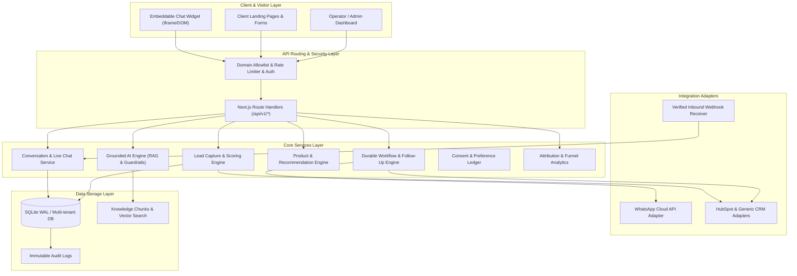

# System Architecture & Technical Specifications

## 1. System Overview

The **Website AI & Conversion Automation Platform** is architected as a modular monolith providing high reliability, sub-second visitor response times, grounded conversational AI, deterministic live-agent handoff, and durable workflow automation.

---

## 2. Logical Components and Boundaries

### A. Website Chat Widget
- **Role**: Visitor-facing conversational interface embedded on client websites.
- **Security**: Embed script with public `siteId`, verified against tenant domain allowlists.
- **Capabilities**: Pre-chat greetings, grounded RAG answering, streaming/typing states, product recommendations cards, progressive lead collection, human handoff trigger, and session persistence in `localStorage`.

### B. Conversation & Session Service
- **State Machine**:
  `AI_ACTIVE` -> `HANDOFF_REQUESTED` -> `HUMAN_ASSIGNED` -> `HUMAN_ACTIVE` -> `RESOLVED`
- **Ownership**: Stores conversation threads, messages (VISITOR, AI, AGENT, SYSTEM), response latency, and citations.

### C. Grounded AI Orchestration & RAG Engine
- **Source Ingestion**: Ingests Business FAQs, Service descriptions, Catalog entries, and Public URLs with strict sanitization.
- **Grounding Policy**: Generates answers strictly from approved sources. When information is missing, it explicitly admits it and provides next actionable steps (request human agent or submit lead inquiry).
- **Security Guardrails**: Strips prompt injections, system override attempts, and hides internal instruction boundaries.

### D. Lead Capture, Qualification & Scoring
- **Progressive Profiling**: Gathers intent, contact email/phone, service requirements, timeline, and budget.
- **Lead Scoring Rules**:
  - Quote request: +40 pts
  - Callback or direct contact request: +30 pts
  - Service specific inquiry: +20 pts
  - Verified phone / email provided: +15 pts
  - Standard FAQ browse: +5 pts
  - Tier classifications: High (>= 60), Medium (30-59), Low (< 30).

### E. Product & Service Catalog Recommendation Engine
- Structured catalog storing prices, tiers, feature lists, categories, and direct action URLs.
- Evaluates visitor requirements against catalog metadata to return verified structured recommendation cards.

### F. WhatsApp & CRM Integration Adapters
- **WhatsApp Cloud API**: Webhook verification (`hub.challenge`), HMAC signature checking, 24-hour conversational window check, approved template messaging, and immediate opt-out compliance.
- **CRM Adapter**: Standardized interface supporting HubSpot and Generic Webhook CRM with automatic retry queues, idempotency tokens, and synchronization status tracking (`PENDING`, `SYNCED`, `FAILED`).

### G. Durable Workflow & Follow-Up Engine
- Evaluates triggers (e.g. `LEAD_CAPTURED`, `CONVERSATION_RESOLVED`), enforces quiet hours, checks explicit consent records, and executes steps with exponential backoff and jitter.

### H. Consent & Preferences Service
- Unified ledger recording: `lead_id`, `channel`, `purpose`, `status` (`OPTED_IN` / `OPTED_OUT`), `policy_version`, `timestamp`, and `revocation_timestamp`.

### I. Analytics & Attribution Service
- Structured telemetry capturing exact events: `widget_opened`, `conversation_started`, `answer_provided`, `answer_fallback_used`, `human_handoff_requested`, `lead_captured`, `crm_sync_succeeded`, etc.
- Funnel computations and latency/cost telemetry.
