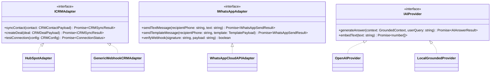

# Integrations Guide & Provider Contracts

## 1. Integration Architecture Overview

All external services connect through normalized adapter interfaces. This decouples business logic from specific vendor SDKs and enables mock/test simulation, zero-downtime provider substitution, and resilient offline recovery.

---

## 2. WhatsApp Business Cloud API Integration

### Setup Requirements
1. Meta Developer Account with WhatsApp Business App ID.
2. Verified Phone Number & Business Account ID (WABA).
3. Permanent System User Access Token with `whatsapp_business_messaging` permissions.
4. Webhook Verify Token & App Secret for HMAC `sha256` validation.

### Webhook Verification Handshake
- Endpoint: `GET /api/v1/webhooks/whatsapp`
- Query Params:
  - `hub.mode`: `"subscribe"`
  - `hub.verify_token`: Verified against configured tenant token.
  - `hub.challenge`: Echoed back with status 200.

### Inbound Message Handling
- Endpoint: `POST /api/v1/webhooks/whatsapp`
- Header: `x-hub-signature-256`
- Processing:
  1. Validate HMAC signature against App Secret.
  2. Parse incoming `messages` array.
  3. Detect Opt-out keywords (`STOP`, `UNSUBSCRIBE`, `CANCEL`) -> triggers instant consent revocation.
  4. Deduplicate message using Meta `message.id`.
  5. Route to Conversation Service.

### Outbound Rules & Policies
- 24-hour customer care window is strictly enforced.
- Outside 24h, only Meta-approved utility/marketing templates can be sent.
- Never send unsolicited promotional broadcasts.

---

## 3. CRM Integrations (HubSpot & Webhook)

### HubSpot Integration
- Authentication: Private App Access Token or OAuth2 bearer token.
- Supported operations:
  - Search contact by normalized email.
  - Create / update contact properties: `firstname`, `lastname`, `email`, `phone`, `company`, `lead_score`, `lead_source`, `last_inquiry`.
  - Create note or engagement containing chat conversation summary.
  - Create pipeline deal when intent threshold is satisfied.
- Retry Policy: Exponential backoff (1s, 4s, 16s, 64s) with jitter. Maximum 5 attempts before marking as `FAILED` in Sync Queue.

### Generic Webhook CRM Adapter
- For custom internal CRMs, Zapier, Make.com, or ERP systems.
- Sends cryptographically signed JSON payload (`x-webhook-signature`) with normalized lead data.

---

## 4. Grounded AI Provider Integration

- Default engine provides deterministic lexical & semantic retrieval over indexed knowledge sources.
- Compatible with OpenAI, Anthropic, or local model endpoints.
- Zero-cost, zero-latency local fallback ensures the widget remains 100% operational even during cloud AI provider downtime or quota exhaustion.
